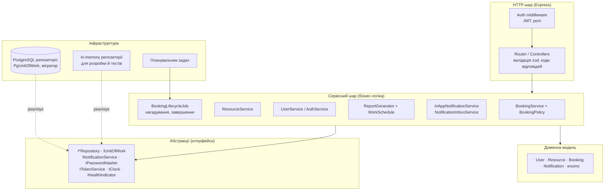

# Архітектура та структура коду

Документ пов'язує архітектурні рішення з Лабораторної роботи №2 із фактичною структурою коду. Як компоненти інтегровані й розгорнуті, описано в [integration-report.md](integration-report.md).

## 1. Архітектурний стиль

**Модульний моноліт** з трирівневою структурою: `React SPA → Node.js REST API → PostgreSQL`.

- Один сервер і одна БД дозволяють гарантувати ACID-транзакції під час бронювання без розподілених транзакцій.
- Код розділено на доменні модулі (`auth`, `users`, `resources`, `bookings`, `analytics`, `notifications`). Модулі взаємодіють лише через інтерфейси, тож за потреби будь-який із них можна винести в окремий сервіс.

## 2. Шари серверного застосунку



Залежності спрямовані **всередину**: контролери знають про сервіси, сервіси — про доменну модель та інтерфейси, а інфраструктура реалізує інтерфейси. Конкретні реалізації зв'язуються лише в одному місці — `server/src/container.ts` (Composition Root).

| Шар | Каталог | Відповідальність |
|---|---|---|
| HTTP | `server/src/modules/*/*.controller.ts`, `server/src/shared/http/` | Маршрути, валідація вхідних даних, HTTP-коди, формат помилок |
| Сервіси | `server/src/modules/*/*.service.ts`, `booking.policy.ts`, `report-generator.ts`, `booking-lifecycle.job.ts` | Сценарії використання та бізнес-правила |
| Домен | `server/src/domain/` | Сутності з поведінкою та інваріантами |
| Абстракції | `server/src/modules/*/*.repository.ts`, `modules/unit-of-work.ts`, інтерфейси `I*` | Контракти, від яких залежить бізнес-логіка |
| Інфраструктура | `server/src/infrastructure/` | PostgreSQL і міграції, in-memory сховище, планувальник, демо-дані |
| Спільне | `server/src/shared/` | Помилки, час і часові пояси, робочий графік, health-check |

## 3. Відповідність діаграмі класів (Лаб №2)

| Елемент діаграми | Реалізація | Примітка |
|---|---|---|
| `User` (id, fullName, email, passwordHash, role, department) | `domain/user.ts` | Додано `position` (потрібно для FR-02, FR-13) |
| `User.createBooking()`, `User.cancelBooking()` | `BookingService.createBooking()`, `BookingService.cancelBooking()` | Винесено із сутності за SRP: бронювання потребує транзакції, політик і сповіщень |
| `Resource` (id, name, type, floor, status, attributes JSON) | `domain/resource.ts` | `attributes`: `zone`, `capacity`, `equipment` |
| `Resource.isAvailable(startTime, endTime)` | `Resource.isAvailable(start, end, bookings)` | Наявні бронювання передаються явно — сутність не звертається до БД |
| `Booking` (id, userId, resourceId, startTime, endTime, status, createdAt) | `domain/booking.ts` | Додано `reminderSentAt` (FR-11) і `reschedule()` |
| `Booking.confirm()` | `Booking.create()` | Бронювання створюється одразу `CONFIRMED` після успішної перевірки колізій |
| `Booking.cancel()` | `Booking.cancel()` | Перевіряє, що бронювання активне |
| `ReportGenerator.generateCSVReport(startDate, endDate)` | `modules/analytics/report-generator.ts` | FR-07 |
| `ReportGenerator.calculateUtilizationRate(resourceId, period)` | там само | Рахує в робочих вікнах `WorkSchedule` без періодів простою |
| `Role`, `ResourceType`, `ResourceStatus`, `BookingStatus` | `domain/enums.ts` | Додано `NotificationType` |

Компоненти з діаграми компонентів відповідають модулям: **Auth Module (JWT)** → `modules/auth`, **Booking Service** → `modules/bookings`, **Resource Service** → `modules/resources`, **Analytics Service** → `modules/analytics`, **Data Access Layer** → `infrastructure/`.

## 4. Контроль колізій (FR-04)

Сценарій з діаграми послідовностей реалізовано в `BookingService.createBooking()` (і `rescheduleBooking()`) через `IUnitOfWork`:

1. `BEGIN`
2. `SELECT … FROM resources WHERE id = $1 FOR UPDATE` — блокування **рядка ресурсу**;
3. пошук активних бронювань, що перетинаються з інтервалом;
4. є перетин → `ROLLBACK` і `409 Conflict`; немає → `INSERT` і `COMMIT` → `201 Created`.

> **Уточнення до діаграми послідовностей.** На діаграмі `FOR UPDATE` застосовується до вибірки з `bookings`. Якщо слот вільний, ця вибірка порожня — блокувати нічого, і два паралельні запити можуть обидва вставити бронювання. Тому блокується рядок ресурсу: усі транзакції бронювання одного ресурсу виконуються строго послідовно.

Друга лінія захисту — обмеження в БД (`server/db/migrations/001_init.sql`):

```sql
CONSTRAINT bookings_no_overlap EXCLUDE USING gist (
    resource_id WITH =, tstzrange(start_time, end_time, '[)') WITH &&
) WHERE (status = 'CONFIRMED')
```

Те саме блокування використовує `ResourceService.changeStatus()`: поки адміністратор блокує ресурс і скасовує його бронювання, нове бронювання цього ресурсу «проскочити» не може.

Підтверджено тестами на справжньому PostgreSQL: 20 паралельних транзакцій → рівно одна успішна; пряма вставка перетину в обхід сервісу → помилка обмеження БД.

## 5. Сповіщення та фонові задачі (FR-02, FR-11)

- Сервіси надсилають сповіщення через `INotificationService`. У `container.ts` це `CompositeNotificationService`, що розсилає в два канали: `InAppNotificationService` (зберігає в БД для дзвіночка в інтерфейсі) і `ConsoleNotificationService` (журнал). Помилка доставки не скасовує бронювання.
- `BookingLifecycleJob` запускається планувальником щохвилини: переводить завершені бронювання в `COMPLETED` і надсилає нагадування за `REMINDER_MINUTES_BEFORE` хвилин. Нагадування «захоплюються» одним `UPDATE … RETURNING`, тому навіть кілька екземплярів API не надішлють дублікатів.

## 6. Принципи SOLID у коді

| Принцип | Де застосовано |
|---|---|
| **S** — Single Responsibility | `BookingPolicy` лише перевіряє правила офісу; `BookingService` лише оркеструє сценарій; `NotificationInboxService` (читання сповіщень) відокремлений від доставки; `WorkSchedule` лише обчислює робочі вікна |
| **O** — Open/Closed | Новий канал сповіщень (email, Slack) — нова реалізація `INotificationService`, яку додають у `CompositeNotificationService` без зміни сервісів. Правила офісу та графік змінюються конфігурацією |
| **L** — Liskov Substitution | `InMemory*Repository` та `Pg*Repository` взаємозамінні: ті самі сервіси перевірено з обома (in-memory — модульні тести, PostgreSQL — інтеграційні) |
| **I** — Interface Segregation | Вузькі інтерфейси: `IPasswordHasher`, `ITokenService`, `IClock`, `IHealthIndicator`. `TransactionalRepositories` дає транзакції лише ті репозиторії, які їй потрібні |
| **D** — Dependency Inversion | Сервіси залежать від абстракцій (`IBookingRepository`, `IUnitOfWork`, `IClock`…), а не від `pg` чи `bcrypt`. Конкретні класи підставляються в `container.ts` |

## 7. Клієнтський застосунок

| Каталог | Відповідальність |
|---|---|
| `client/src/api/` | HTTP-клієнт (`http.ts`: базовий URL, JWT, помилки) і функції для кожного ресурсу API |
| `client/src/context/` | `AuthContext` — стан сесії користувача |
| `client/src/components/` | `Layout`, `ProtectedRoute`, `ResourceCard`, `ResourceFilters`, `ResourceCalendar` (FR-10), `NotificationBell` (FR-11) |
| `client/src/pages/` | Вхід, пошук ресурсів, мої бронювання, адміністрування (завантажується окремим чанком) |
| `client/src/utils/` | Чисті функції (сітка слотів, валідація слота, правило 15 хв, підписи) — покриті тестами |
| `client/src/types/` | TypeScript-типи DTO, що відповідають контракту API |

Сторінки не викликають `fetch` напряму — лише функції з `api/`, тож зміна формату API торкається одного місця.

## 8. База даних і міграції

Схема описана SQL-міграціями в `server/db/migrations/` (`001_init.sql`, `002_notifications_reminders_downtime.sql`). API застосовує нові міграції при старті (`MIGRATE_ON_START=true`): кожна — у власній транзакції, застосовані записуються в `schema_migrations`, паралельний запуск кількох екземплярів виключено advisory-блокуванням.

## 9. Як розширювати

- **Новий модуль**: `server/src/modules/<name>/` з `*.repository.ts` (інтерфейс), `*.service.ts`, `*.controller.ts`; реалізації репозиторію — в `infrastructure/`; підключення — в `container.ts` та `app.ts`.
- **Нове сховище**: реалізувати інтерфейси репозиторіїв і `IUnitOfWork`, додати гілку в `createStorage()` у `container.ts`.
- **Новий канал сповіщень**: реалізувати `INotificationService` і додати його в `CompositeNotificationService` у `container.ts`.
- **Зміна схеми БД**: новий файл `NNN_опис.sql` у `server/db/migrations/`.
