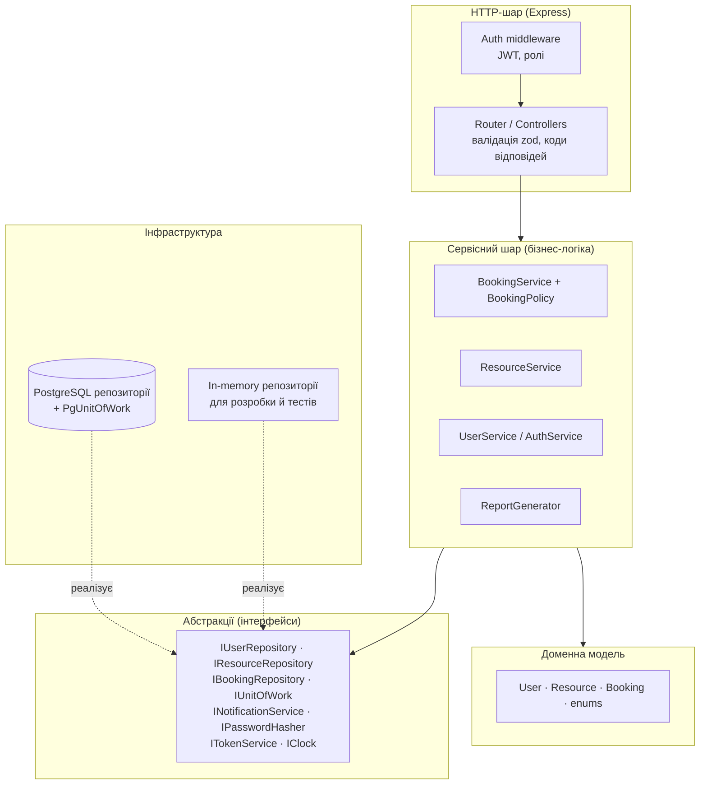

# Архітектура та структура коду

Документ пов'язує архітектурні рішення з Лабораторної роботи №2 із фактичною структурою коду.

## 1. Архітектурний стиль

**Модульний моноліт** з трирівневою структурою: `React SPA → Node.js REST API → PostgreSQL`.

- Один сервер і одна БД дозволяють гарантувати ACID-транзакції під час бронювання без розподілених транзакцій.
- Код розділено на доменні модулі (`auth`, `users`, `resources`, `bookings`, `analytics`, `notifications`). Модулі взаємодіють лише через інтерфейси, тож за потреби будь-який із них можна винести в окремий сервіс.

## 2. Шари серверного застосунку



Залежності спрямовані **всередину**: контролери знають про сервіси, сервіси — про доменну модель та інтерфейси, а інфраструктура реалізує інтерфейси. Конкретні реалізації зв'язуються лише в одному місці — `server/src/container.ts` (Composition Root).

| Шар | Каталог | Відповідальність |
|---|---|---|
| HTTP | `server/src/modules/*/*.controller.ts`, `server/src/shared/http/` | Маршрути, валідація вхідних даних, HTTP-коди, формат помилок |
| Сервіси | `server/src/modules/*/*.service.ts`, `booking.policy.ts`, `report-generator.ts` | Сценарії використання та бізнес-правила |
| Домен | `server/src/domain/` | Сутності з поведінкою та інваріантами |
| Абстракції | `server/src/modules/*/*.repository.ts`, `unit-of-work.ts`, інтерфейси `I*` | Контракти, від яких залежить бізнес-логіка |
| Інфраструктура | `server/src/infrastructure/` | PostgreSQL, in-memory сховище, демо-дані |

## 3. Відповідність діаграмі класів (Лаб №2)

| Елемент діаграми | Реалізація | Примітка |
|---|---|---|
| `User` (id, fullName, email, passwordHash, role, department) | `domain/user.ts` | Додано `position` (потрібно для FR-02, FR-13) |
| `User.createBooking()`, `User.cancelBooking()` | `BookingService.createBooking()`, `BookingService.cancelBooking()` | Винесено із сутності за SRP: бронювання потребує транзакції, політик і сповіщень |
| `Resource` (id, name, type, floor, status, attributes JSON) | `domain/resource.ts` | `attributes`: `zone`, `capacity`, `equipment` |
| `Resource.isAvailable(startTime, endTime)` | `Resource.isAvailable(start, end, bookings)` | Наявні бронювання передаються явно — сутність не звертається до БД |
| `Booking` (id, userId, resourceId, startTime, endTime, status, createdAt) | `domain/booking.ts` | |
| `Booking.confirm()` | `Booking.create()` | Бронювання створюється одразу `CONFIRMED` після успішної перевірки колізій |
| `Booking.cancel()` | `Booking.cancel()` | Перевіряє, що бронювання активне |
| `ReportGenerator.generateCSVReport(startDate, endDate)` | `modules/analytics/report-generator.ts` | FR-07 |
| `ReportGenerator.calculateUtilizationRate(resourceId, period)` | там само | |
| `Role`, `ResourceType`, `ResourceStatus`, `BookingStatus` | `domain/enums.ts` | |

Компоненти з діаграми компонентів відповідають модулям: **Auth Module (JWT)** → `modules/auth`, **Booking Service** → `modules/bookings`, **Resource Service** → `modules/resources`, **Analytics Service** → `modules/analytics`, **Data Access Layer** → `infrastructure/`.

## 4. Контроль колізій (FR-04)

Сценарій з діаграми послідовностей реалізовано в `BookingService.createBooking()` через `IUnitOfWork`:

1. `BEGIN`
2. `SELECT … FROM resources WHERE id = $1 FOR UPDATE` — блокування **рядка ресурсу**;
3. пошук активних бронювань, що перетинаються з інтервалом;
4. є перетин → `ROLLBACK` і `409 Conflict`; немає → `INSERT` і `COMMIT` → `201 Created`.

> **Уточнення до діаграми послідовностей.** На діаграмі `FOR UPDATE` застосовується до вибірки з `bookings`. Якщо слот вільний, ця вибірка порожня — блокувати нічого, і два паралельні запити можуть обидва вставити бронювання. Тому блокується рядок ресурсу: усі транзакції бронювання одного ресурсу виконуються строго послідовно.

Друга лінія захисту — обмеження в БД (`server/db/migrations/001_init.sql`):

```sql
CONSTRAINT bookings_no_overlap EXCLUDE USING gist (
    resource_id WITH =, tstzrange(start_time, end_time, '[)') WITH &&
) WHERE (status = 'CONFIRMED')
```

Інтервали напіввідкриті `[start, end)`: слоти 10:00–11:00 та 11:00–12:00 не конфліктують.

## 5. Принципи SOLID у коді

| Принцип | Де застосовано |
|---|---|
| **S** — Single Responsibility | `BookingPolicy` лише перевіряє правила офісу; `BookingService` лише оркеструє сценарій; контролери лише перетворюють HTTP ↔ виклики сервісів; `ReportGenerator` лише рахує звіти |
| **O** — Open/Closed | Новий канал сповіщень (email, Slack) — нова реалізація `INotificationService` без зміни `BookingService`. Правила офісу (`BookingRules`) змінюються конфігурацією, а не кодом |
| **L** — Liskov Substitution | `InMemory*Repository` та `Pg*Repository` взаємозамінні: ті самі сервіси працюють з обома (in-memory — у тестах, PostgreSQL — у Docker) |
| **I** — Interface Segregation | Вузькі інтерфейси: `IPasswordHasher` (2 методи), `ITokenService` (2 методи), `IClock` (1 метод). `TransactionalRepositories` дає транзакції лише ті репозиторії, які їй потрібні |
| **D** — Dependency Inversion | Сервіси залежать від абстракцій (`IBookingRepository`, `IUnitOfWork`, `IClock`…), а не від `pg` чи `bcrypt`. Конкретні класи підставляються в `container.ts` |

## 6. Клієнтський застосунок

| Каталог | Відповідальність |
|---|---|
| `client/src/api/` | HTTP-клієнт (`http.ts`: базовий URL, JWT, помилки) і функції для кожного ресурсу API |
| `client/src/context/` | `AuthContext` — стан сесії користувача |
| `client/src/components/` | Повторно використовувані компоненти: `Layout`, `ProtectedRoute`, `ResourceCard`, `ResourceFilters` |
| `client/src/pages/` | Сторінки: вхід, пошук ресурсів, мої бронювання, адміністрування |
| `client/src/utils/` | Чисті функції (валідація слота, правило 15 хв, підписи) — покриті тестами |
| `client/src/types/` | TypeScript-типи DTO, що відповідають контракту API |

Сторінки не викликають `fetch` напряму — лише функції з `api/`, тож зміна формату API торкається одного місця.

## 7. Як розширювати

- **Новий модуль**: `server/src/modules/<name>/` з `*.repository.ts` (інтерфейс), `*.service.ts`, `*.controller.ts`; реалізації репозиторію — в `infrastructure/`; підключення — в `container.ts` та `app.ts`.
- **Нове сховище**: реалізувати інтерфейси репозиторіїв і `IUnitOfWork`, додати гілку в `createRepositories()` у `container.ts`.
- **Нагадування перед бронюванням (FR-11)**: планувальник, що викликає `INotificationService` з типом `BOOKING_REMINDER`.
